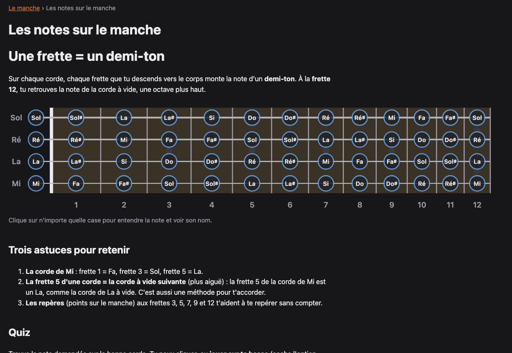
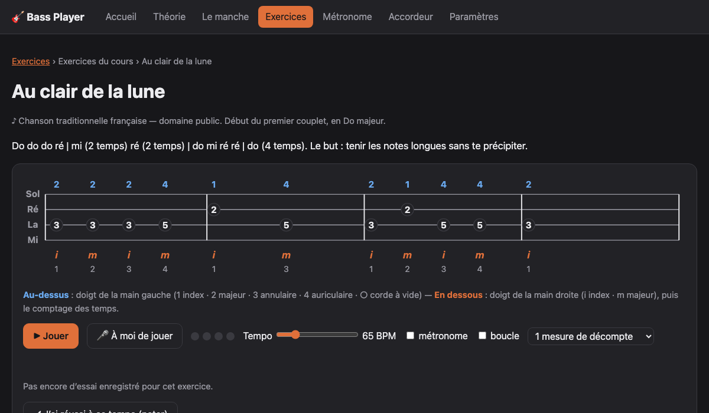
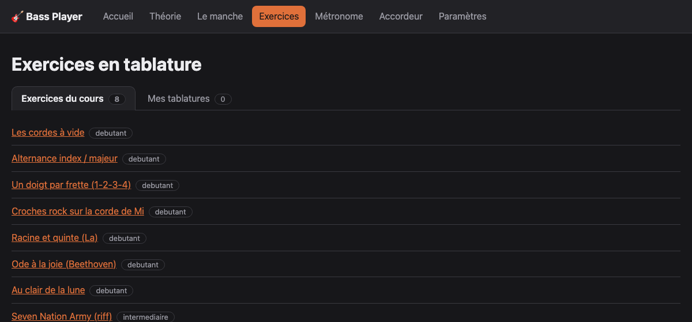
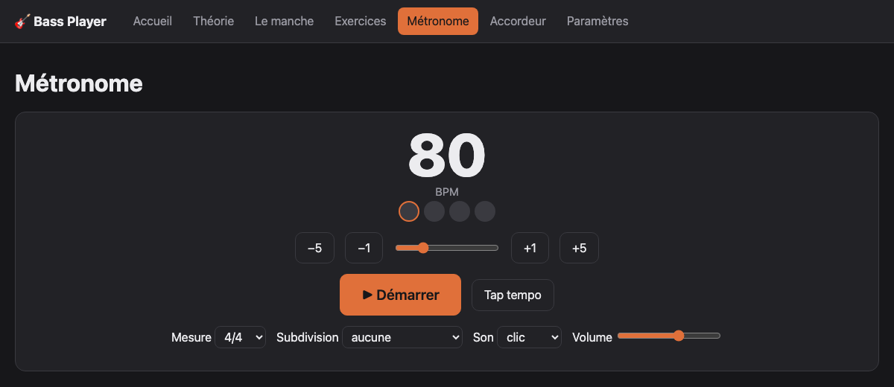
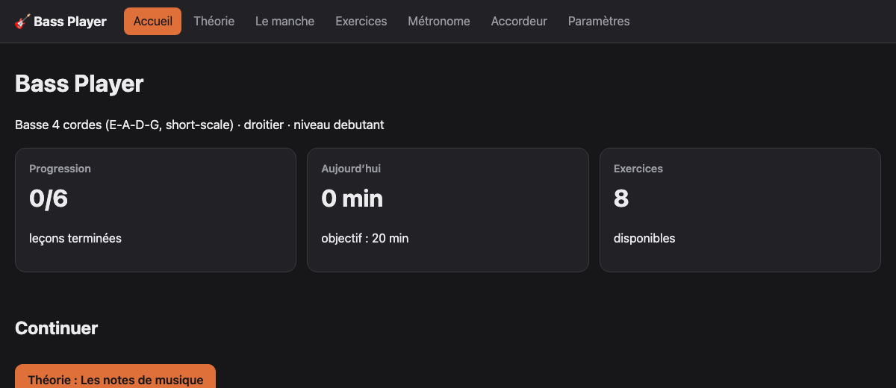

# Bass Player

Application web locale pour apprendre la basse : théorie, manche, tablatures interactives,
métronome, accordeur, écoute au micro.

## Aperçu

**Un manche interactif** : chaque case se clique pour entendre la note, avec son nom en notation française ou anglaise.

**Des exercices en tablature** avec le doigté de chaque main, le comptage des temps, la lecture sonore, le métronome et la
validation de ce que tu joues au micro.

**Deux onglets** pour séparer les exercices du cours et tes propres tablatures.

**Un métronome** (tempo, mesure, subdivisions, tap tempo) et **un tableau de bord** de progression.

## Démarrer

    npm install
    npm start                      # ouvre http://localhost:3000
    npm start -- --port 4000       # autre port (ou PORT=4000 npm start, ou serveur.port dans config.yml)
    npm test

## Moteur et données personnelles

Deux parties indépendantes, prévues pour deux dépôts git :

| | Dépôt | Contenu |
|---|---|---|
| **Moteur** | public | `server/`, `web/`, `content/` (cours et exercices), `test/`, `config.example.yml`, `player.example.md` |
| **Tes données** | privé | `perso/` : `player.md`, `config.yml`, `data/`, `backups/` |

Le dossier `perso/` est ignoré par le moteur. Il se crée tout seul au premier lancement à partir des
fichiers `*.example.*`. Pour le placer ailleurs (par exemple ton dépôt privé cloné à côté) :

    npm start -- --perso ../bass-data      # ou BASS_PERSO=../bass-data npm start

| Dans `perso/` | Rôle |
|---|---|
| `player.md` | Ton profil : main dominante, basse, niveau, notation des notes |
| `config.yml` | Configuration (port, audio, micro, sauvegardes…) — modèle : `config.example.yml` |
| `data/` | Progression, sessions du jour, un fichier par exercice, quiz, réglages |
| `data/mes-tablatures/` | Tes propres tablatures (`.yml`, même format que `content/exercices/`) |
| `backups/` | Copie automatique de `data/` (une par jour, 30 conservées), non versionnée |

## Format d'une tablature

    titre: Mon exercice
    bpm: 60
    chiffrage: "4/4"
    notes: "E0 A3/0.5 A5/0.5 -/1 D2 | G5"

| Jeton | Sens |
|---|---|
| `E0`, `A3` | corde (B E A D G) + frette |
| `Ax` | note morte (étouffée) sur la corde de La |
| `/0.5`, `/.25`, `/1:3` | durée en temps (1 par défaut) ; `/1:3` = un tiers de temps (triolet) |
| `-` | silence (`-/.5` = demi-soupir) |
| `\|` | barre de mesure (affichage) |
| `h` `p` | hammer-on / pull-off vers la note suivante (`E3/.25h E4`) |
| `s` | glissé vers la note suivante (`A5/.5s A12`) |
| `t` | liaison : la note suivante, identique, est tenue et non rejouée (`G10/.5t G10/1`) |
| `b` | bend d'un quart de ton |
| `*` | staccato |

La note qui suit un `h`, `p`, `s` ou `t` n'est pas pincée : pas de lettre de main droite, pas de validation au micro
pour les glissés et liaisons. Les doigtés de la main de frette sont calculés automatiquement
(un doigt par frette) ; ajoute `doigtes_gauche: aucun` pour les masquer quand la main se déplace.
Mets les textes contenant « : » entre guillemets.

Vérifier des tablatures (YAML, jetons, bon nombre de temps par mesure), y compris celles de `perso/` :

    npm run verifier

## Écrire une leçon

Markdown avec en-tête `titre`, `resume`. Blocs interactifs : `fretboard`, `tab`, `quiz`, `mains`
(en bloc de code avec ce nom comme langage). Variables : `{{main_pince}}`, `{{main_frette}}`, `{{dominante}}`.
